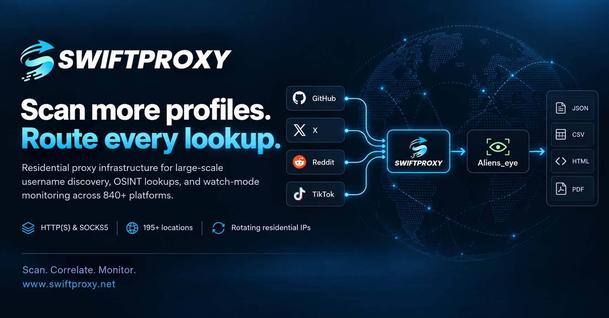

<h1 align="center">ALIENS EYE</h1>

<div align="center">
  
</div>

<h1 align="center">AI-OSINT Username Scanner</h1>

<h3 align="center">Advanced AI-Powered Social Media Username Finder</h3>
<h4 align="center">Scan 7,700+ platforms with ML-blended detection</h4>

<p align="center">
<a href="https://pypi.org/project/aliens-eye/"></a>
<a href="https://github.com/arxhr007/Aliens_eye/actions/workflows/ci.yml"></a>
<a href="#"></a>
<a href="#"></a>
<a href="#"></a>
</p>

<!-- TODO: record a demo GIF (e.g. with vhs or asciinema) and drop it at docs/demo.gif -->
<!-- <p align="center"></p> -->

---

## 🐧 New from the author: lxask

**[lxask](https://github.com/arxhr007/lxask)** is a Linux command assistant that runs entirely on your own machine:
describe what you want in plain English and it suggests the command. No API key, no cloud, about 1 GB on disk, no GPU.
If you find Aliens Eye useful, a ⭐ on [lxask](https://github.com/arxhr007/lxask) helps a lot.

To hide the gold box about it under the Aliens Eye banner, set `ALIENS_EYE_NO_PROMO=1`.

---

## 💙 Sponsored by Swiftproxy

<p align="center">
  <a href="https://www.swiftproxy.net/?ref=Alienseye">
    
  </a>
</p>

Power your web scraping and data collection with **[Swiftproxy](https://www.swiftproxy.net/?ref=Alienseye)** — a residential proxy provider offering rotating and static residential proxies for reliable, efficient data access.

- **90M+ residential IPs** across 220+ locations
- **Protocols:** HTTP(S) and SOCKS5
- **Flexible sessions:** Rotating and sticky
- **Pricing:** Plans starting at $0.7/GB
- **Discount:** Get an additional 10% off with code `PROXY90`
- **Free trials available**

[**Explore Swiftproxy →**](https://www.swiftproxy.net/?ref=Alienseye)


---

## Highlights

- **7,700+ platforms** with `--catalog extended`, **780+** in the default catalog, scanned asynchronously
- **ML + heuristic detection** — a trained model blended with 30 structural signals (HTTP status, DOM shape, keywords, fingerprints) instead of naive status-code checks
- **Profile extraction** — display name, bio, and avatar pulled from each hit (OpenGraph / JSON-LD / per-site CSS)
- **Cross-site correlation** — cluster profiles that look like the same person by avatar hash, bio, shared links, and name (`--correlate`)
- **Recursive expansion** — follow linked usernames out of bios and re-scan them (`--recurse-depth N`)
- **Domain check** — is `<username>.{com,io,net,…}` registered and live? (`--domains`)
- **Watch mode** — re-scan on an interval and alert on changes, optionally to a webhook (`--watch 6h --notify <url>`)
- **Resumable scans** — checkpoint progress and continue after an interruption (`--resume file.jsonl`)
- **Modern terminal UI** — live progress, sorted result tables, summary panels (powered by [rich](https://github.com/Textualize/rich)); plus an interactive browser (`aliens_eye tui`, optional extra)
- **MCP server** — expose scanning to LLM agents (`aliens_eye serve`, optional extra)
- **Proxy & Tor support** — `--proxy socks5://...` or just `--tor`
- **Site filtering** — `--site github,reddit`, `--exclude-site`, `--no-nsfw`, plus drop-in `sites.d/` plugin site maps
- **A second opinion on every Found** — the site is also asked for a username that cannot exist; if it shows the same page, the hit is downgraded to Maybe
- **Calibrated self-check** — `aliens_eye selfcheck` reports precision / recall / F1 / FPR per site
- **Reproducible evaluation** — record a frozen response corpus once, then replay it for identical metrics run to run (`aliens_eye corpus record` / `selfcheck --corpus`)
- **Ablations and baselines** — `aliens_eye eval ablate` scores detector configurations with bootstrap confidence intervals; `eval external` compares against Sherlock / Maigret / WhatsMyName rules on the same stored responses
- **Retrainable + active learning** — retrain with `aliens_eye train`, or hand-label uncertain hits with `aliens_eye label`
- **Reports** in JSON, CSV, HTML, Markdown, PDF, and graph formats (GEXF, Mermaid, Maltego CSV)
- **Playwright fallback** for JavaScript-heavy pages (optional extra)

## Install

```bash
pip install aliens-eye
```

Optional extras:

```bash
pip install "aliens-eye[browser]"   # Playwright fallback for hard pages
python -m playwright install chromium

pip install "aliens-eye[train]"     # scikit-learn, for retraining the ML model
pip install "aliens-eye[correlate]" # Pillow, for avatar-image matching in --correlate
pip install "aliens-eye[pdf]"       # reportlab, for --format pdf
pip install "aliens-eye[tui]"       # textual, for the interactive `tui` browser
pip install "aliens-eye[serve]"     # mcp, for the `serve` MCP server
```

Or with Docker:

```bash
docker build -t aliens-eye .
docker run --rm -it aliens-eye username
```

From source:

```bash
git clone https://github.com/arxhr007/Aliens_eye.git
cd Aliens_eye
pip install -e .
```

## Usage

```bash
# Interactive prompts
aliens_eye

# Single username
aliens_eye username

# Multiple usernames
aliens_eye username1 username2

# Advanced scan level (prefix/suffix variations)
aliens_eye username -l advanced

# Only scan specific sites
aliens_eye username --site github,reddit,gitlab

# Skip NSFW sites
aliens_eye username --no-nsfw

# Route through Tor (needs a local Tor daemon)
aliens_eye username --tor

# Any HTTP or SOCKS proxy
aliens_eye username --proxy socks5://127.0.0.1:1080

# Export everything
aliens_eye username --format all --output results

# Heuristics only, no ML
aliens_eye username --no-ml

# Non-interactive preset: quick / full / aggressive
aliens_eye username --profile quick

# Plain output for scripts and CI (no colors/progress)
aliens_eye username --plain

# The report as JSON on stdout, one line per username; the banner, progress and summary go to stderr
aliens_eye username --json-stdout | jq '.variations[].sites | to_entries[] | select(.value.status == "Found") | .value.url'

# Only Found/Maybe sites in the report (the counts still cover every site scanned)
aliens_eye username --json-stdout --only-found

# View results from a previous scan
aliens_eye -r results/username_advanced_20260611_120000.json

# Correlate hits into "likely same person" clusters + check domains
aliens_eye username --correlate --domains

# Follow linked usernames out of found bios and re-scan them
aliens_eye username --recurse-depth 1

# Export a graph of the results (import into Gephi / Maltego / Mermaid)
aliens_eye username --correlate --format gexf,mermaid,maltego

# Investigator PDF with embedded avatars
aliens_eye username --format pdf

# Watch for changes every 6 hours and POST them to a webhook
aliens_eye username --watch 6h --notify https://hooks.example/aliens

# Resume an interrupted scan
aliens_eye username --resume scan.jsonl

# Compare two saved reports
aliens_eye diff results/old.json results/new.json

# Validate detection accuracy (precision / recall / F1 per site)
aliens_eye selfcheck --negatives 2 --report json

# Record a frozen response corpus, then evaluate against it reproducibly
aliens_eye corpus record --out corpus/v1 --split all --negatives 4
aliens_eye corpus stats corpus/v1
aliens_eye selfcheck --split holdout --corpus corpus/v1 --report json

# Compare detector configurations over that corpus, with confidence intervals
aliens_eye eval ablate --corpus corpus/v1 --split holdout

# Compare against Sherlock / Maigret / WhatsMyName rules (fetch their data yourself)
aliens_eye eval external --corpus corpus/v1 --sherlock data.json --whatsmyname wmn-data.json

# Rebuild the ground-truth splits from those projects account lists
aliens_eye eval groundtruth --sherlock data.json --whatsmyname wmn-data.json

# Interactively label uncertain hits into a training set
aliens_eye label results/username_basic_20260611_120000.json --out labeled.csv

# Interactive terminal browser (needs [tui])
aliens_eye tui username

# Run the MCP server for LLM agents (needs [serve])
aliens_eye serve
```

Custom platforms: drop a `{ "site_name": "https://site/{}" }` JSON file into
`./sites.d/` (or the user config dir's `sites.d/`) and it is merged automatically;
`--sites-dir DIR` adds another location.

### Expanded community catalog

The default catalog has **788 sites**. The opt-in expanded catalog contains
**7,710 enabled definitions**, combining pinned community site databases with
unique, valid standard-catalog templates. Entries for the same profile URL merge
into one, keeping the other names as aliases, and an active rule replaces one a
source marks disabled.

Every entry was checked live on 2026-11-07 (see below). Sites that reported a
made-up username as existing, and sites that failed twice (unreachable, or a
known account no longer found), were disabled in the expanded catalog and
removed from the default one, except 56 default sites the ground-truth splits
depend on. Of the remaining entries, about 4,900 confirmed a known account and
rejected a made-up one; the rest answered with blocks, challenges or uncertain
pages from the checking network. A check is a snapshot, not a guarantee.

```bash
aliens_eye sites stats --catalog extended
aliens_eye sites validate --catalog extended
aliens_eye sites list --catalog extended --tag coding
aliens_eye your_handle --catalog extended --tag coding --no-nsfw --explain
```

The expanded catalog preserves engine rules, separate public-profile/API-probe
URLs, username constraints, tags, aliases, disabled entries, upstream revision,
file hashes, and MIT notices. Its manifest records 1,575 disabled definitions,
121 excluded entries and 898 duplicate-template merges. Disabled and excluded
definitions are not scanned. Filters can match aliases; `--source maigret`,
`--source sherlock`, or `--source aliens-eye` selects a source when present.
Use filters before starting a broad scan: the extended catalog makes many more
requests than the standard catalog.

To check which entries still work, `scripts/verify_catalog.py` requests one
username an upstream project or the curated ground truth says exists and one
generated username per site, then replays the captured responses through the
scanner's own per-site check:

```bash
# live: about two requests per enabled site; rerun the same command to resume
python scripts/verify_catalog.py record --corpus runs/verify \
    --upstream-data path/to/data.json
# offline: summary.json + sites.csv with a verdict per site
python scripts/verify_catalog.py report --corpus runs/verify --out runs/verify-report
```

Verdicts are `working`, `alive_no_test_user`, `misses_known_user`,
`accepts_anything` (a made-up username was reported Found), `uncertain`,
`blocked` and `unreachable`. A result describes one moment from one network;
upstream "known" accounts can be deleted, so `misses_known_user` is not proof
that a rule is broken.

Local imports do not download data or execute upstream code. They inspect by
default; `--out` writes a new file and refuses to overwrite an existing one:

```bash
aliens_eye sites import --maigret path/to/maigret/resources/data.json --with-standard --out imported-sites.json
aliens_eye sites import --sherlock path/to/sherlock_project/resources/data.json --out sherlock-sites.json
aliens_eye your_handle --sites imported-sites.json --explain
```

Use `--maigret-revision` / `--sherlock-revision` to record the reviewed source
revision. The recorded SHA-256 identifies the supplied file; it does not prove
that an arbitrary file came from the named project. Review upstream terms and
import exclusions before distributing a new snapshot.

The initial adapter supports public GET requests. Authentication/activation,
credential-bearing headers, POST payloads, unsupported identifier types,
ambiguous username searches, unsupported regexes and malformed templates are excluded
rather than silently treated as supported. Probe requests validate public
destinations and redirects; custom headers are not forwarded across origins.
Imported definitions do not use browser fallback. Proxy-side DNS remains a
trust boundary, as with other proxy-enabled fetches.

For HTML, site evidence complements the existing ML/heuristic detector.
Conflicting markers or rule/model disagreement remain uncertain. Public JSON
probes require an explicit matching username and rule evidence; the HTML model
is not presented as a calibrated JSON classifier. An unavailable or positive
negative-control response cannot confirm an imported hit. `--no-control-check`
explicitly disables that safeguard. Results retain the public profile URL and
record probe/rule/provenance details under `ai_analysis`.

Maigret and Sherlock data use their respective MIT notices, included in catalog
source metadata. No new WhatsMyName data is bundled by this importer. Existing
ground-truth records marked `source: whatsmyname` originate from the
[WhatsMyName project](https://github.com/WebBreacher/WhatsMyName), copyright
2015–2026 Micah Hoffman, licensed [CC BY-SA 4.0](http://creativecommons.org/licenses/by-sa/4.0/).
Those records are adapted account lists and must not be relabeled as MIT. The project code's MIT
license does not replace third-party data terms.

## How detection works

HTML detection uses a 30-dimensional feature vector: HTTP status buckets, username placement (path/title/meta/canonical), error and profile keywords, DOM structure (images, forms, profile/error CSS classes), structured-data signals (og:type, JSON-LD Person), response timing, redirect counts, and, in the legacy scan path, per-site fingerprint matches learned from previous scans.

Two judges then vote:

1. **Heuristic engine** — weighted scoring over the features
2. **ML model** — logistic regression trained on labeled scans of real (and deliberately fake) accounts, shipped with the package and running in pure Python (no sklearn needed at runtime)

The blended probability maps to **Found / Maybe / Not Found** with a confidence percentage. The loaded model supplies both the blend weight and the thresholds — the shipped model uses `0.9 * ml + 0.1 * heuristic`, Found above `0.620`, Not Found below `0.360`. If a model file is missing or invalid, the scanner silently falls back to heuristics with the defaults in `core/detector.py` (`0.4` ML weight, `0.6` / `0.35` thresholds). See [WORKING.md](WORKING.md) for the full table.

A **Found** then has to survive three checks, because a page is scored on how profile-like it looks and error pages, challenge pages and empty JavaScript shells can look the part:

- an HTTP `404`/`410` is reported as Not Found, and any other error code as Maybe at most;
- a bot-check or error page is capped at Maybe;
- the site is asked for a random control username, and if it answers with the same page, the result is capped at Maybe (`--no-control-check` skips this; it costs one extra request per Found).

> **Treat Found/Maybe as leads to verify, not as findings or proof of identity.** The shipped model was fit on 1,455 samples and is unchanged by the catalog expansion. Archived benchmark results describe particular captured responses, not current live accuracy. Historical splits used site names, and aliases such as `chess` / `chess.com` cross that boundary; older “unseen platform” claims therefore need qualification. New training collection excludes holdout host groups, and new grouped cross-validation keeps aliases together. Source-provided account labels still require independent review.

### Retraining the model

```bash
pip install "aliens-eye[train]"

# 1. Scan ground-truth accounts + random non-existent usernames to build a dataset
#    (reads the train split only; the eval holdout is never touched)
aliens_eye train collect --out dataset.csv --negatives 4

# 2. Fit and export the model
aliens_eye train fit --data dataset.csv --out model.json

# 3. Score it on platforms it never trained on
aliens_eye selfcheck --split holdout --model model.json --report json

# 4. Use it
aliens_eye username --model model.json
```

The stored ground-truth files contain 286 train and 142 holdout site-name entries,
not that many independent platforms. New collection protects holdout host groups
and records `site`, `site_group`, `label_source` and `split` alongside features.
Scoring `--split train` measures fit, not generalization.

Reuse a locally captured corpus without network access:

```bash
aliens_eye train collect --corpus corpus --out grouped-dataset.csv
aliens_eye train fit --data grouped-dataset.csv --out candidate-model.json --max-fpr 0.02
```

Training fits scalers inside each fold, uses grouped folds when provenance is
available, and selects blend weights/thresholds from nested out-of-fold
predictions. `--max-fpr` constrains calibration-set false positives; it is not a
guarantee for unseen sites. Legacy feature-only CSVs remain readable but are
explicitly labeled `row-stratified-legacy`, not unseen-site validation. Selection
CV F1 is not an independent test score. Compare candidate precision **and recall**
on a separate holdout before replacing the shipped model.

#### Training on the expanded catalog

`scripts/train_expanded.py` gives the model labeled pages from expanded-catalog
sites. Positives are the usernames the upstream site databases and the curated
train split assert exist; negatives are generated. Only sites whose profile page is the request qualify: API probes,
disabled and NSFW (unless `--include-nsfw`) sites are skipped, as is every site
whose host group overlaps the bundled holdout. Every artifact goes into one
`--work` directory and no stage overwrites an existing file.

```bash
# prepare (offline): ground truth + training site list
python scripts/train_expanded.py prepare --work runs/exp1 \
    --upstream-data path/to/data.json --max-sites 600
# record (live network): profile pages + 4 negatives/site into a frozen corpus
python scripts/train_expanded.py record --work runs/exp1
# collect, fit, compare (offline): grouped CSV, candidate model, holdout comparison
python scripts/train_expanded.py collect --work runs/exp1
python scripts/train_expanded.py fit --work runs/exp1
python scripts/train_expanded.py compare --work runs/exp1 --holdout-corpus path/to/holdout-corpus
```

`--upstream-data` must be the same `data.json` snapshot the catalog was built from
(checked by SHA-256). Upstream usernames are assertions, not verified accounts;
positives that now return 404 are dropped during collection. `compare` scores
the shipped and candidate models on the holdout and writes `comparison.json`; the
shipped model is never replaced automatically. Record the holdout corpus with
`aliens_eye corpus record --split holdout`.

This trainer remains an HTML model trainer: JSON/API feature-model training
requires a separately labeled corpus and is not simulated by feeding JSON to the
HTML classifier. Maigret external evaluation now expands its nested engines and
matches endpoint templates. Missing API-probe captures or incompatible request
policies are reported as unsupported/undecided, not borrowed from profile pages
or fetched live.

## Using it as a library

`aliens_eye.api` is the stable surface for building other tools on Aliens Eye. It
returns plain dicts shaped like the JSON report and prints nothing by default.

```python
import asyncio
from aliens_eye import api

async def main():
    sites = api.load_sites(exclude_nsfw=True)
    report = await api.scan(
        "someone",
        sites=sites,
        on_result=lambda user, r: print(r["site"], r["status"]),  # optional progress hook
    )
    correlation = await api.correlate(report)
    print(len(correlation["clusters"]), "clusters")

asyncio.run(main())
```

For expanded scans, pass the metadata-carrying mapping through unchanged:

```python
sites = api.load_sites(catalog="extended", tags=["coding"], exclude_nsfw=True)
report = await api.scan("your_handle", sites=sites)
```

The mapping still exposes `{site: URL template}`. Converting it with `dict()` or
serializing only that URL view discards its rule metadata; use the versioned
catalog file for portable structured definitions. Replacing a URL in the mapping
removes stale probe rules for that entry.

It can also read a profile link back into a site and username, and fetch a page
whose address came from somewhere you don't control:

```python
api.match_profile_url("https://www.instagram.com/_someone_/")
# [ProfileMatch(site='instagram', username='_someone_')]

page = await api.fetch_page("https://example.com/")   # public http(s) addresses only
```

Everything outside `aliens_eye.api` is internal and may change between minor releases.

## Configuration

Aliens Eye merges a JSON config file with CLI flags (CLI wins). Search order without `--config`: `./config.json`, then the platform config dir (e.g. `~/.config/aliens_eye/config.json` on Linux, `%LOCALAPPDATA%\aliens_eye` on Windows).

```json
{
  "concurrent": 50,
  "timeout": 10.0,
  "retries": 2,
  "rate_limit_delay": 0.2,
  "output_dir": "results",
  "output_formats": ["json", "csv", "html", "md"],
  "use_playwright": false,
  "proxy": null,
  "use_ml": true,
  "exclude_nsfw": false,
  "level": "basic"
}
```

## Outputs

Results are saved with timestamped filenames:

- `username_level_YYYYMMDD_HHMMSS.json` — full detail including per-site feature analysis
- `.csv` — flat rows for spreadsheets
- `.html` — styled standalone report
- `.md` — Markdown summary of Found/Maybe hits

## Architecture

The package lives under `src/aliens_eye/`: `core/` (scanner, detector, analyzer, http, exporter, fingerprints), `ml/` (inference, training, dataset collection), `utils/` (rich console layer), and `data/` (sites.json, trained model, ground-truth sets). For internals and flowcharts, see [WORKING.md](WORKING.md).

## Contributing

Issues and PRs welcome — adding sites to `src/aliens_eye/data/sites.json`, expanding the ground-truth set in `selfcheck.json`, or improving the model all directly improve detection. See [CONTRIBUTING.md](CONTRIBUTING.md) for setup, checks, and how detection changes are measured, and [CODE_OF_CONDUCT.md](CODE_OF_CONDUCT.md) for community standards.

## Disclaimer

This tool is for educational purposes and legitimate OSINT research only. You are responsible for complying with laws and site terms of service.
